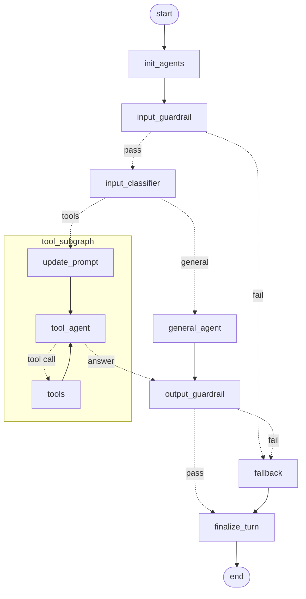

# langgraph-chatbot-framework

A starter template for building chatbots with [LangGraph](https://langchain-ai.github.io/langgraph/), served by a FastAPI API.

It ships with a working flow you can rename, extend or rip out:

- **Input and output guardrails**: an LLM checks every user message and every answer. Blocked turns get a safe fallback reply.
- **Classifier router**: a small model decides which agent should answer.
- **General agent**: small talk and general questions, with no tools.
- **Tool agent subgraph**: a tool-calling loop with a Qdrant RAG tool (embeddings plus reranking) and two example tools.
- **Per-session memory**: conversation state is checkpointed in Postgres (Supabase), keyed by `session_id`. Each agent also sees the recent turns the user had with the other agents.

LLMs are called through [OpenRouter](https://openrouter.ai), but any LangChain chat model works.

## Flow



The running API also serves the live diagram at `GET /chatbot/get-graph`, so it stays accurate as you change the graph.

## Requirements

- Python 3.13 and [uv](https://docs.astral.sh/uv/)
- A [Supabase](https://supabase.com) project, used as the Postgres database for conversation memory
- An [OpenRouter](https://openrouter.ai/keys) API key
- A [Qdrant Cloud](https://cloud.qdrant.io) cluster, only needed for the RAG tool

## Quickstart

1. Click **Use this template** on GitHub to create your own repo, then clone it.
2. Install dependencies:

   ```bash
   uv sync
   ```

3. Create your `.env` and fill it in. Every variable is explained in `.env.example`.

   ```bash
   cp .env.example .env
   ```

   `SUPABASE_POSTGRES_URI` and `OPENROUTER_API_KEY` are required. In Supabase, use the **Direct connection** or **Session pooler** URI from *Dashboard → Connect*. The LangGraph checkpoint tables are created automatically on first start.

4. Optional: load sample documents into Qdrant so the RAG tool has something to find.

   ```bash
   uv run python -m scripts.seed_qdrant
   ```

5. Start the API:

   ```bash
   uv run main.py
   ```

   Interactive docs are at http://localhost:8000/docs.

6. Send a message:

   ```bash
   curl -X POST http://localhost:8000/chatbot/message \
     -H "Content-Type: application/json" \
     -d '{"input_message": "what can you do?", "session_id": "0001", "username": "Leo1"}'
   ```

   ```json
   {
     "input_message": "what can you do?",
     "output_message": "Hello! I'm here to help you with...",
     "route": "general_agent",
     "input_guardrail": "PASS",
     "output_guardrail": "PASS"
   }
   ```

   Reuse the same `session_id` to continue the conversation.

## Customizing

| To change... | Look at |
| --- | --- |
| The flow: nodes, edges, routing | `src/graph/graph_builder.py` |
| Prompts, language and fallback messages | `src/graph/prompts.py` |
| Tools available to the tool agent | `src/tools/__init__.py` (`ALL_TOOLS`) |
| LLM provider and models | `src/services/chat_models.py` and the `LLM_*` variables in `.env` |
| RAG: embedding model, collection layout, reranker | `src/config/rag_config.py` |
| Environment variables | `src/config/settings.py` and `.env.example` |

**Adding a tool**: write a LangChain `@tool` function (see `src/tools/example_single_tool.py`) and add it to `ALL_TOOLS`. The agent and the `ToolNode` both read that list.

**Adding an agent**:
1. Add a category in `src/graph/agents/input_classifier_agent.py` (`Category` and `CATEGORY_TO_AGENT`), and describe it in `get_input_classifier_prompt()`.
2. Give the agent a message list in `src/graph/state.py` and a system prompt in `src/graph/init_agents.py`.
3. Add the node and its edges in `src/graph/graph_builder.py`. `general_agent.py` is a good model to copy.

## Project structure

```
main.py                   # starts uvicorn
scripts/seed_qdrant.py    # loads sample documents into Qdrant
src/
├── api/                  # FastAPI app, routes and request/response schemas
├── config/               # settings from .env, RAG settings
├── graph/
│   ├── graph_builder.py  # the main graph
│   ├── state.py          # shared graph state
│   ├── prompts.py
│   ├── agents/           # general, tool, classifier and fallback nodes
│   ├── guardrails/       # input and output guardrails
│   ├── routers/          # conditional-edge functions
│   └── subgraphs/        # tool-calling subgraph
├── services/             # graph compilation with the Postgres checkpointer, chat models, embeddings
├── tools/                # tools for the tool agent
└── utils/                # memory, Qdrant and reranker helpers
```

## Before you deploy

- **Add authentication.** The API trusts the `session_id` and `username` it receives, so anyone who knows a `session_id` can read and continue that conversation.
- **Never commit `.env`.** It's already in `.gitignore`.
- Guardrails reduce risk but don't remove it. Review `src/graph/prompts.py` for your use case.

## License

[MIT](LICENSE)
